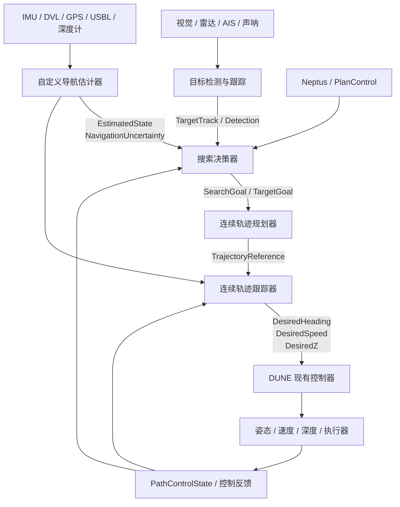
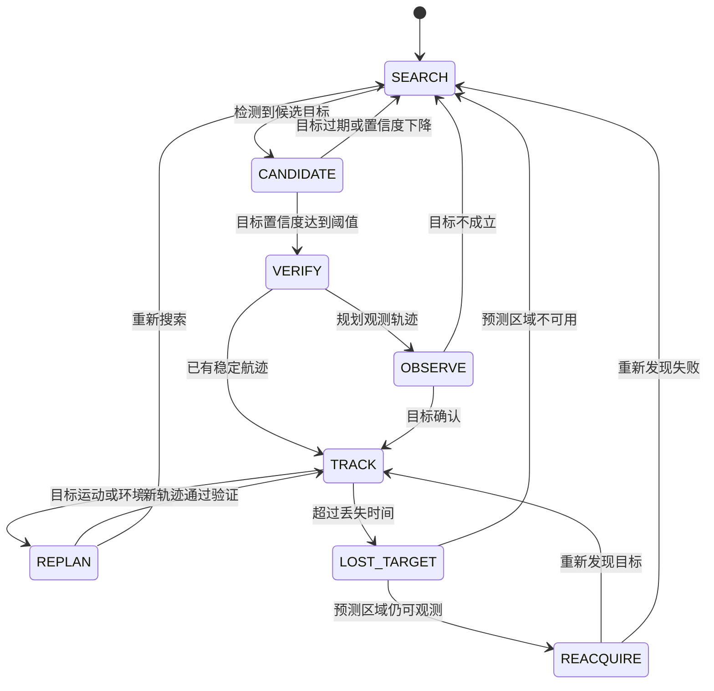

# DUNE 连续型自主搜索系统设计

## 1. 目标与范围

本文档描述一种部署在 DUNE 上的海上可疑目标自主搜索系统。系统从传感器数据中发现和跟踪目标，由上层搜索算法选择下一步行动，在线生成满足载体约束的连续轨迹，并交给 DUNE 的底层控制器执行。

目标是形成以下闭环：

```text
传感器 → 目标检测与跟踪 → 搜索决策 → 连续轨迹规划 → 连续轨迹跟踪
   ↑                                                        ↓
   └────────────── EstimatedState 和执行反馈 ────────────────┘
```

DUNE 负责任务调度、IMC 消息、状态发布、底层控制和安全监控。目标识别模型、搜索策略、轨迹优化和状态估计算法由自定义模块实现。

## 2. 总体架构



各模块应保持单一职责：

| 模块 | 主要职责 | 不负责的内容 |
| --- | --- | --- |
| 自定义导航估计器 | 融合本艇传感器，发布本艇状态 | 选择目标和规划搜索策略 |
| 目标检测与跟踪 | 检测目标、分类、数据关联和运动预测 | 直接控制舵面或推进器 |
| 搜索决策器 | 维护搜索状态、评估目标、选择下一行动 | 处理执行器细节 |
| 连续轨迹规划器 | 生成带动力学和环境约束的轨迹 | 直接驱动执行器 |
| 连续轨迹跟踪器 | 将轨迹转换为航向、速度和深度参考 | 选择任务目标 |
| DUNE 底层控制与监控 | 执行控制参考、故障处理和安全降级 | 目标识别和全局搜索决策 |

搜索决策器、规划器和跟踪器可以是三个 DUNE 任务，也可以在原型阶段合并为一个任务。稳定后建议拆分，以便单独测试和替换。

## 3. DUNE 和 IMC 接口

### 3.1 本艇状态

自定义导航任务应发布唯一的权威状态：

- `IMC::EstimatedState`：位置、姿态、速度、深度和高度。
- `IMC::NavigationUncertainty`：位置不确定度和协方差相关信息。
- `IMC::NavigationData`：需要记录的导航诊断数据。

已有的 `Navigation/AUV/Navigation` 任务继承 `BasicNavigation`，可以复用传感器订阅、实体解析、缓冲和部分状态发布逻辑。若算法不是 EKF，直接继承 `DUNE::Tasks::Periodic` 通常更清晰。替换现有估计器时，应关闭原任务，避免多个任务同时发布 `EstimatedState`。

### 3.2 目标信息

现有 `IMC::Target` 包含：

- 目标标签；
- 纬度、经度和 Z 参考；
- 对地航向和速度。

它适合仿真和简单跟踪。可疑目标搜索通常还需要目标类型、置信度、位置协方差、轨迹编号、最后观测时间、传感器来源和识别特征。原型阶段可以使用 `Target` 加 `custom` 参数；系统稳定后建议定义新的 IMC 消息，例如 `TargetTrack` 或 `DetectionReport`，并同步更新 IMC 绑定和 Neptus 显示。

仓库中的 `Simulators/Target` 可产生模拟目标，`Maneuver/FollowTarget` 可作为目标跟踪接口的参考实现。它们不能代替目标检测、分类和搜索决策算法。

### 3.3 规划和执行接口

推荐按以下层次使用消息：

| 方向 | 消息 | 用途 |
| --- | --- | --- |
| 搜索决策 → 规划器 | 自定义内部结构或 `Reference` | 目标点、观测点、搜索区域和约束 |
| 规划器 → 跟踪器 | 自定义内部轨迹结构 | 曲线参数、速度、曲率和有效时间 |
| 跟踪器 → DUNE 控制器 | `DesiredHeading`、`DesiredSpeed`、`DesiredZ` | 连续控制参考 |
| 兼容现有路径控制 | `DesiredPath` | 短航段或滚动时域近似 |
| 执行反馈 | `PathControlState` | 跟踪误差、终点距离和路径状态 |
| 动态参考方案 | `Reference`、`FollowReference` | 快速原型和在线参考点更新 |

`DesiredPath` 以两个端点描述路径段，适合当前默认 `PathController`。真正的连续曲线应由自定义轨迹跟踪器直接根据曲线参数计算切向方向和曲率；也可以先用滚动时域方式不断发送短航段，逐步替换为原生曲线跟踪。

## 4. 可疑目标搜索逻辑

搜索任务应把“发现目标”和“决定如何行动”分开。一个可用的状态机如下：



目标选择评分可以综合：

- 目标分类和识别置信度；
- 航向、速度和行为异常程度；
- 历史航迹的稳定性；
- 目标与本艇的距离、接近风险和预计观测收益；
- 海流、禁航区、浅水区和障碍物约束；
- 剩余电量、通信范围、任务时间和返航要求。

搜索决策器应输出“下一步去哪里以及为什么去”，而不是输出舵角。规划器再把目标转换为可执行轨迹。

## 5. 连续轨迹生成和跟踪

规划器可以维护参数化轨迹：

\[
\mathbf p(s) = [x(s), y(s), z(s)], \qquad s \in [0, 1]
\]

每个周期根据当前 `EstimatedState` 和目标预测状态计算：

1. 轨迹上的最近点参数 `s`；
2. 切向方向和航向参考；
3. 曲率、允许速度和加速度；
4. 横向误差、纵向误差和剩余时间；
5. 目标丢失或约束违反时的备用轨迹。

曲线可以从圆、Bezier、B-spline、Clothoid 或优化器输出开始。海上平台必须显式考虑最大转弯率、最小转弯半径、最大速度、最大加速度、深度变化率和海流影响。

跟踪器建议以固定频率运行，例如 10--20 Hz。它读取最新状态和轨迹版本，输出：

```text
DesiredHeading
DesiredSpeed
DesiredZ
```

输出仍由 DUNE 的姿态、速度和深度控制器执行，这样可以继续使用现有的控制回路、执行器分配、限幅、失联处理和故障监控。

## 6. 在线重规划

重规划由事件触发，并可辅以固定周期检查。典型触发条件包括：

- 发现置信度更高的新目标；
- 目标运动模型发生明显变化；
- 当前目标丢失或预测误差超过阈值；
- 发现障碍物、禁航区或浅水区；
- 本艇导航不确定度过大；
- 路径跟踪误差过大；
- 通信、电量或任务剩余时间发生变化。

新轨迹必须经过验证后才替换当前轨迹。建议为每条轨迹维护递增的 `trajectory_id` 或 `path_ref`，并检查有效时间，防止旧消息覆盖新规划。

推荐的替换流程是：

```text
接收新目标/环境变化
    → 生成候选轨迹
    → 检查碰撞、曲率、速度、深度和通信约束
    → 检查起点与当前状态的连续性
    → 原子替换当前轨迹
    → 发布新的控制参考
```

规划失败时，应继续执行上一条安全轨迹；如果上一条轨迹也不再安全，则进入盘旋、悬停、返航或上浮等预设行为。搜索任务不应在没有有效轨迹时持续发送未验证的控制参考。

## 7. 建议的代码组织

DUNE 支持扫描 `user/` 目录中的任务。建议在 DUNE 源码仓库中使用以下结构：

```text
dune/user/src/Navigation/CustomNavigation/Task.cpp
dune/user/src/Navigation/CustomNavigation/Task.cmake
dune/user/src/Autonomy/TargetSearch/Task.cpp
dune/user/src/Autonomy/TargetSearch/Task.cmake
dune/user/src/Control/Path/Continuous/Task.cpp
dune/user/src/Control/Path/Continuous/Task.cmake
```

每个任务内部再把 DUNE 适配层和纯算法分开：

```text
Task.cpp                 // bind、consume、周期调度、dispatch
TargetTracker.hpp/.cpp   // 目标关联和运动预测
SearchPlanner.hpp/.cpp   // 目标评分和搜索决策
Trajectory.hpp/.cpp      // 曲线表示和几何计算
TrajectoryPlanner.hpp    // 约束检查和轨迹生成
```

建议的配置段名称为：

```ini
[Navigation.CustomNavigation]
Enabled = Always

[Autonomy.TargetSearch]
Enabled = Always

[Control.Path.Continuous]
Enabled = Always
```

替换原有导航或路径控制任务时，先关闭冲突任务。例如自定义状态估计器启用后，应将 `[Navigation.AUV.Navigation]` 设为 `Enabled = Never`。一个载体只能有一个权威的 `EstimatedState` 发布者；同一控制回路也不应同时接收多个互相竞争的航向参考。

## 8. 实施阶段

### 阶段 0：接口和仿真基线

- 保持现有导航和 `VectorField` 不变。
- 使用 `Simulators/Target` 生成移动目标。
- 记录 `EstimatedState`、`Target`、`DesiredPath` 和 `PathControlState`。
- 确认仿真中的坐标系、单位、时间戳和实体 ID。

### 阶段 1：目标搜索决策

- 编写 `Autonomy/TargetSearch`。
- 订阅 `EstimatedState` 和目标消息。
- 实现目标列表、置信度、超时和状态机。
- 先输出 `Reference` 或短航段，使用现有控制器执行。

### 阶段 2：连续轨迹跟踪

- 实现圆形或 Bezier 曲线。
- 计算最近点、切向方向和横向误差。
- 发布 `DesiredHeading`、`DesiredSpeed` 和 `DesiredZ`。
- 与 `VectorField` 比较跟踪误差、航向变化和速度表现。

### 阶段 3：自定义导航估计

- 先通过日志回放验证 EKF、UKF 或其他估计器。
- 在仿真中替换现有导航任务。
- 验证 `EstimatedState` 的有效性、协方差和失效处理。

### 阶段 4：在线规划和安全降级

- 加入目标运动预测、障碍物和禁航区约束。
- 实现事件触发的重规划和轨迹版本控制。
- 测试目标丢失、定位异常、通信中断和规划失败。

### 阶段 5：Neptus 和真实平台集成

- 稳定算法后再扩展 IMC 消息和 Neptus 插件。
- 增加目标轨迹、置信度、当前规划和重规划原因的可视化。
- 在硬件在环、浅水测试和海试中逐级验证。

## 9. 安全与验收标准

规划和跟踪模块必须服从 DUNE 的安全边界。至少应验证：

- 最大速度、最大转弯率和最小转弯半径；
- 深度、海底高度和水面约束；
- 禁航区、障碍物和安全距离；
- 导航不确定度超限时的降级行为；
- 目标丢失、传感器异常和消息超时；
- 通信中断、电量不足和返航策略；
- 新旧轨迹切换时的位置、航向和速度连续性。

建议记录以下指标：目标检测延迟、目标跟踪误差、规划耗时、重规划成功率、横向跟踪误差、航向变化率、轨迹切换次数和安全降级次数。

## 10. 预期结果

该架构可以先在 DUNE/Neptus 仿真中完成“发现目标—选择目标—生成轨迹—执行—重规划”的闭环，再逐步部署到真实 AUV、USV 或其他海上无人平台。

最初不需要修改 Neptus 的计划编辑器：Neptus 只需启动搜索任务并提供区域或任务参数，搜索任务在 DUNE 内部完成目标选择和在线规划。待算法稳定后，再通过新的 IMC 消息和 Neptus 插件实现曲线编辑、目标信息显示和规划过程可视化。

